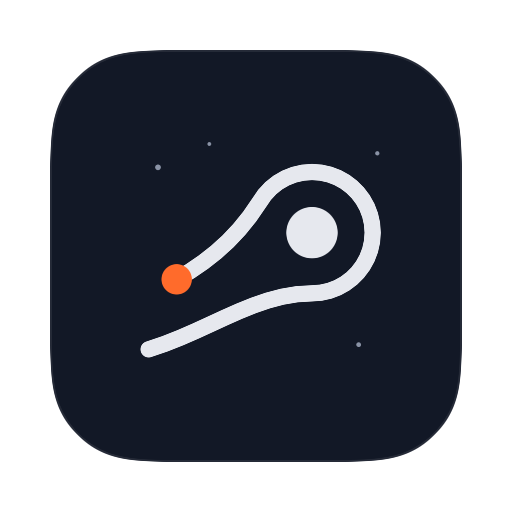

<p align="center">
  
</p>

<h1 align="center">Flyby</h1>

A macOS menu bar app for Apple Silicon that shows what your Mac is doing and gives you a few small controls the system lacks: a per-app volume mixer, a profile-based Dock and independent scroll direction for mouse and trackpad.

The interface is available in English and Brazilian Portuguese. It follows the system language (Portuguese if macOS prefers it, English otherwise) and can be changed any time in `Preferences > Language`; the change applies immediately. Item names below are the English ones; in Portuguese they are Preferências, Perfis, Atualizações do app and so on.

## Features

### Monitoring
- **CPU %**: processor usage via Mach APIs
- **RAM %**: memory usage via `vm_statistics64`
- **Thermal state**: the system's official thermal state (Nominal, Fair, Serious, Critical)
- **Menu bar readout**: the values you pick sit next to the menu bar icon, and the thermal indicator appears only when the Mac runs warm
- **Configurable refresh**: 1, 2, 5, 10 or 30 seconds

### Volume mixer
- **Master volume and mute** of the default output device
- **Per-app volume**: any app that is playing audio shows up in the panel with its own slider and mute button, up to 100%
- Apps are controlled with Core Audio process taps, so this part needs **macOS 14.2 or later**. On older versions the mixer still controls the master volume
- macOS asks for audio capture permission the first time you change an app's volume

### Flyby Dock
An optional replacement for the macOS Dock, with the same glass look and profiles of apps.

- **Profiles**: each profile is its own set of pinned apps, such as one for browsing and music and another for development
- **Switch by scrolling** while the pointer is over the Dock. A trackpad swipe switches once per gesture, and each mouse wheel notch switches one profile. A column of dots shows which profile is active
- **Drag and drop**: drag an app from Finder onto the Dock to pin it to the active profile, reorder icons by dragging, or drag a pinned app well outside the Dock to remove it
- **Running apps** appear after the divider like on the native Dock. You can also show apps that are pinned to other profiles
- **Downloads** icon: click it to see your latest files above the Dock and drag them to Finder, to other apps or to the Trash
- **Trash** icon: opens the Trash, and files dropped on it are moved to the Trash. It always shows the empty icon, because macOS does not let apps see whether the Trash is full
- **Auto-hide** on by default
- Finder is fixed and shows in every profile
- It is off by default. While it is on, the native Dock is hidden. Turning it off or quitting Flyby restores your original Dock settings, and if Flyby crashes it restores them on the next launch

Enable it in `Preferences > Dock` and edit profiles in `Preferences > Dock > Profiles`.

### Scroll direction
macOS has a single "natural scrolling" switch for every device. Flyby lets you reverse the mouse and the trackpad **independently**, so you can have the wheel work like on Windows while the trackpad stays natural.

- Both options are off by default
- It needs **Accessibility** permission. Flyby asks for it when you turn an option on, and shows a shortcut to the settings if it is still missing

### App
- **Launch at login**
- **Menu bar icon** that can be hidden, and a choice of app icons
- **Self-updating**: checks GitHub Releases at launch and every 5 hours. Installing is always a click in `Preferences > App updates`; the download is verified with `SHA256SUMS` and `codesign` before it replaces the app

## Requirements

- macOS 13.0 (Ventura) or later
- Apple Silicon (M1, M2, M3, M4, M5)
- macOS 14.2 or later for the per-app volume
- Xcode 15.3+ only if you build from source

## Download

If you just want to use Flyby, you do not need to build it:

1. Download `Flyby-macos-arm64.dmg` from the [Releases page](https://github.com/femitz/flyby/releases).
2. Open the DMG and drag `Flyby` onto the `Applications` shortcut.
3. The app is ad-hoc signed but not notarized by Apple, so on first launch right-click `Flyby.app` in Applications and choose `Open` once. Alternatively, remove the quarantine flag:
   ```bash
   xattr -dr com.apple.quarantine /Applications/Flyby.app
   ```

A `Flyby-macos-arm64.zip` with the bare app and a `SHA256SUMS` file to verify the downloads (`shasum -a 256 -c SHA256SUMS`) are published alongside the DMG.

## Permissions

Flyby asks for each permission only when you use the feature that needs it:

| Permission | Used for | When it is asked |
|------------|----------|------------------|
| Audio capture | Per-app volume | The first time you change an app's volume |
| Accessibility | Reversing the scroll direction | When you turn on `Inverter no mouse` or `Inverter no trackpad` |
| Downloads folder | Listing your latest files in the Dock | The first time you click the Downloads icon |

If you update the app and a feature stops working, check that Flyby is still enabled in `System Settings > Privacy & Security`.

## Installation

To build from source instead:

### 1. Install Command Line Tools (if needed)
```bash
xcode-select --install
```

### 2. Package the app bundle
```bash
./scripts/package-app.sh
```

This creates `dist/Flyby.app`.

### 3. Install to Applications
```bash
./scripts/install-app.sh
```

By default the installer copies `Flyby.app` to `/Applications`. If that folder is not writable, it falls back to `~/Applications`.

### 4. Run without Terminal
- Open `Flyby` from Finder
- Search for `Flyby` in Spotlight
- Search for `Flyby` in Raycast

If macOS warns that the app is from an unidentified developer, right-click `Flyby.app` in Finder and choose `Open` once.

### 5. Add to Login Items (optional)
- Open Flyby once from `/Applications/Flyby.app`
- Enable `Abrir ao iniciar sessão` in the preferences

Running `swift run Flyby` also works for development, but it is not an `.app` bundle: the in-app updater will not install and permission prompts behave differently.

## How It Works

### Menu bar
The title shows the monitors you enabled and refreshes every 2 seconds:
```
CPU 12% · RAM 47%
```
With a single monitor the label is dropped (`12%`). Click it to open the panel.

### Panel
- **Telemetry**: rings for CPU, memory and thermal state
- **Mixer**: master volume and the apps that are playing audio
- **Preferences**: opens inside the panel and has the sections `Monitors`, `Dock`, `Scrolling`, `Refresh rate`, `App icon`, `Language`, `System` and `App updates`

### Thermal state
| State | Description |
|-------|------------|
| Nominal | Normal temperature |
| Fair | Running warm |
| Serious | Hot, may throttle |
| Critical | Reduce load immediately |

Apple does not provide a public API for actual temperature readings. Thermal state is the official API available.

## Project Structure

```
Flyby/
├── Sources/Flyby/
│   ├── App/SystemMonitorApp.swift         # App delegate, menu bar item
│   ├── Design/Brand.swift                 # Palette, fonts, shared components
│   ├── Services/
│   │   ├── SystemMonitorService.swift     # CPU, RAM, thermal
│   │   ├── AppVolumeService.swift         # Per-app volume (Core Audio taps)
│   │   ├── OutputVolumeService.swift      # Master volume and mute
│   │   ├── DockService.swift              # Dock profiles and running apps
│   │   ├── NativeDock.swift               # Hides and restores the macOS Dock
│   │   ├── DownloadsStack.swift           # Latest downloads
│   │   ├── InstalledApps.swift            # App list for the profile editor
│   │   ├── ScrollReverserService.swift    # Scroll direction (event tap)
│   │   └── UpdateService.swift            # GitHub Releases updater
│   ├── Views/
│   │   ├── PanelController.swift          # Menu bar panel
│   │   ├── PanelView.swift                # Telemetry and mixer
│   │   ├── PreferencesView.swift
│   │   ├── DockPanelController.swift      # Dock window, drag and scroll
│   │   ├── DockView.swift
│   │   ├── DockProfilesView.swift         # Profile editor
│   │   ├── DownloadsPopover.swift
│   │   └── DragGhost.swift
│   └── Utilities/
│       ├── Settings.swift                 # UserDefaults-backed settings
│       ├── Localization.swift             # Language and L10n: every UI string, pt-BR and English
│       ├── AppIcon.swift                  # App icons drawn in code
│       └── InstallerBackground.swift      # DMG background drawn in code
├── Resources/App/                         # Info.plist and Flyby.icns
├── scripts/                               # Packaging, install and DMG scripts
└── Package.swift
```

## Troubleshooting

### "App cannot be opened because it is from an unidentified developer"
1. Right-click the app in Finder
2. Select "Open"
3. Click "Open" in the dialog

### Flyby does not appear in Spotlight or Raycast yet
- Confirm the app is installed as `Flyby.app` in `/Applications` or `~/Applications`
- Wait a few seconds for macOS indexing to catch up
- Run `mdimport /Applications/Flyby.app` if you want to force a metadata refresh

### CPU/RAM showing 0%
The app needs a second refresh cycle to calculate CPU usage. Wait 10 seconds for accurate readings.

### Thermal shows "Nominal" always
This is expected: Apple Silicon Macs rarely reach elevated thermal states under normal use.

### An app is not in the mixer
Only apps that are currently playing audio appear. Start playback and it shows up. Per-app volume needs macOS 14.2 or later and the audio capture permission.

### Scroll direction does not change
Flyby needs Accessibility access. Open `System Settings > Privacy & Security > Accessibility`, enable Flyby and wait a couple of seconds. After an update the old grant can go stale: remove Flyby from the list, add it again and toggle the option off and on.

### The macOS Dock is still hidden after Flyby closed
Open Flyby again: with `Dock do Flyby` off it puts your original Dock settings back, and it also does that every time it quits normally. If you cannot open it, set auto-hide and its delay back in `System Settings > Desktop & Dock`.

## License

Flyby is source-available under the [PolyForm Noncommercial License 1.0.0](LICENSE): you can download, use, modify and share it for any noncommercial purpose, and contributions are welcome (see [CONTRIBUTING.md](CONTRIBUTING.md)). Selling it or using it commercially requires the author's permission.
